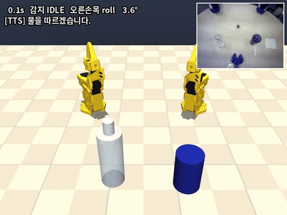
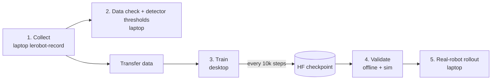
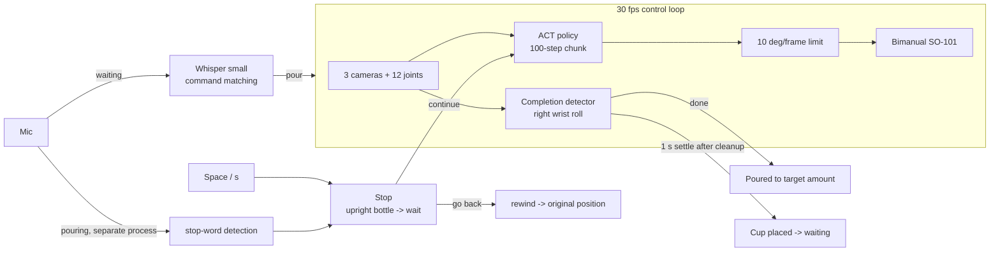

# Voice-Commanded Bimanual Water Pouring

[](https://github.com/J1N462/lerobot_watertask_vla/actions/workflows/tests.yml)

**UNITA Manipulation (Incheon National University)** · PAC 2026 Physical AI Challenge — Track ① self-selected topic.

A bimanual SO-101 robot (LeRobot `bi_so_follower`) pours water on a spoken command. The robot grabs a cup with
its left arm, tilts a bottle with its right arm, pours, places the cup down, and announces completion. An ACT
policy trained from teleoperated demos drives both arms; everything around the policy — voice recognition,
completion detection, spoken feedback, emergency stop, and safe recovery — is built on top.

Core pieces: Whisper voice commands (start, and stop while pouring), a joint-state completion detector
(hysteresis on the pouring wrist, 100/100 on the dataset), non-blocking offline TTS, a stop routine that uprights
the bottle and replays the executed path backwards, a MuJoCo bimanual digital twin for hardware-free testing, and
an offline-ready launcher. 85 unit tests with CI.

<p align="center">
   pour -> completion detection -> TTS">
  <br><sub>Sim demo (camera = recorded demonstration video, arms = MuJoCo). Video with audio: <a href="docs/media/demo_sim.mp4">demo_sim.mp4</a></sub>
</p>

## Demo Scenario

| Step | Human | Robot (spoken feedback) |
|---|---|---|
| 1 | | "Ready. Please give me a command." |
| 2 | **"Pour water"** | "I'll pour water." -> left arm grabs cup, right arm grabs bottle |
| 3 | | Pour -> detect completion from wrist angle -> **"Poured to the target amount."** |
| 4 | | Place cup at marked spot and return -> **"Cup placed. Enjoy."** -> back to step 1 |
| Stop | **"Stop"** or Space while pouring | Upright the bottle first -> "Stopped." -> **pause and wait for "go back" / "continue"** |
| Go back | **"Go back"** (Space / `r`) while paused, or 20 s of silence | **Retrace the path backwards to return cup and bottle** -> "Returned to the original position." |
| Continue | **"Continue"** / "resume" / "pour" (`c`) while paused | "I'll continue pouring." -> the policy resumes pouring from the current pose |

Water volume is matched by **filling only the target amount into the bottle and pouring it fully** (transparent
water cannot be reliably read from a camera).

## Competition Procedure

The wrist-camera mount and gripper change on site, so we **collect and train fresh at the venue**. One laptop
(GTX 1060) handles both collection and rollout; training is delegated remotely to a lab desktop (RTX 5060).



| Stage | Where | What | Command |
|---|---|---|---|
| 1. Collect | laptop | Teleop demos (fixed bottle volume, taped cup spot, consistent speed) | [Collection](#collection) |
| 2. Check | laptop | Verify episode count/length, recompute completion thresholds (10 s) | `python analysis/joint_analysis.py --dataset <data> --install` |
| 3. Train | desktop | Continue from the existing model, push to HF every 10k steps | [Training](#training-desktop) |
| 4. Validate | laptop | Pull checkpoints during training, validate offline + in sim | [Checkpoint validation](#checkpoint-validation) |
| 5. Run | laptop | **First test: "fill, then stop mid-pour -> does water stop?"**, then the full scenario | `bash run_demo.sh` |

Every stage can run over an SSH terminal (Tailscale). Run inside `tmux` to survive disconnects
(`sudo apt install tmux` if missing).

## Laptop Setup

```bash
conda activate lerobot-gpu          # both collection and rollout use this env (reason below)
cd ~/lerobot_watertask_vla
python tools/offline_check.py --block-network   # verify model, Whisper, and mic all load without internet
```

- **Must be `lerobot-gpu`.** The GTX 1060 (Pascal) only uses the GPU with the CUDA 12.6 torch build
  (`2.11.0+cu126`). The `lerobot` env is a cu130 build, so CUDA fails on driver 535, the policy runs on CPU, and
  it stutters ~0.3 s per chunk. `run_demo.sh` and `train/record.sh` automatically prefer `lerobot-gpu` when present.
- Collection and rollout share one robot config: `~/UNITA_PAC2026/local/robot.env` (copy from
  `rollout/robot.env.example` if missing). Fill in ports and camera paths. Use `/dev/v4l/by-id/...` instead of
  `/dev/videoN` (stable across reconnects). If any of the three bimanual cameras is left as a `REPLACE`
  placeholder, `run_demo.sh` blocks the run. Single-arm rehearsal uses the `SINGLE_*` entries.
- Keep 20 GB+ free disk (temporary images during collection are large).
- **Do not set mic input volume too high.** On this laptop, capture at 100% (+30 dB) clips the signal and misses
  short stop words. `amixer -c 0 sset Capture 30` (48%) works. If you swap mics on site, check first with
  `python stt/voice_command.py --mode stream`.

## Running (Rollout)

```bash
bash run_demo.sh                              # real robot
bash run_demo.sh --sim --sim-render window    # no hardware: recorded video + MuJoCo joints (window on laptop screen)
bash run_demo.sh --replay                     # no hardware: replay recorded data as-is
bash run_demo.sh --sim --policy <checkpoint dir> --dataset <data dir>   # new model / new data
bash run_demo.sh --single --policy <single-arm checkpoint> --thresholds <single-arm thresholds.json>   # one-arm rehearsal (SINGLE_* in robot.env)
```

| Control | Waiting | Pouring | Rewinding |
|---|---|---|---|
| Voice | "Pour water" -> start | "Stop" -> stop, then "go back" / "continue" | (not listening) |
| Keyboard | `p`+Enter start, `q`+Enter quit | **Space / `s`** stop, then Space/`r` go back / `c` continue, `q` quit | **Space = immediate freeze (emergency)** |
| Ctrl+C | quit | quit after stop routine | immediate freeze |

Common options (passed through to `pour_rollout.py`):

| Option | Default | When |
|---|---|---|
| `--stt-mode enter` | `stream` (transcribes the last 2 s every 0.5 s for immediate response) | Fallback when voice keeps failing. Enter -> speak -> Enter |
| `--mic <n>` | system default | Headset mic (`python stt/voice_command.py --list-devices`) |
| `--no-voice-stop` | on | Disable voice stop while pouring, keyboard only |
| `--untilt-s 2.5` | 1.5 | Increase if water sloshes while uprighting the bottle on stop |
| `--rewind-speed 0.5` | 0.7 | Lower if rewind feels too fast |
| `--stop-mode rewind` | `ask` | Rewind immediately on stop without asking (`freeze` = stay in place) |
| `--pause-s 30` | 20 | How long to wait for "go back" / "continue" after a stop (rewinds when it elapses) |
| `--post-done-s` | 25 | Max wait for the cleanup motion after completion |

## Control Flow



- **Completion detection**: done when the pouring (right) wrist roll crosses the entry line (78.9 deg) relative to
  the reference pose and then returns within the exit line (39.4 deg). Angles are unwrapped past +/-180 deg to avoid
  mid-pour false positives. Reference lines are refreshed from new data via `--install`.
- **Normal termination**: after completion the policy places the cup down; when arms and grippers hold within
  15 deg of the start pose for 1 s, it ends (up to 25 s).
- **Stop routine** (before pouring completes): (1) if the right wrist is tilted 15 deg or more, upright it to the
  pose just before tilting over 1.5 s, then pause and wait for "go back" / "continue" ("continue" -> the policy
  resumes; the mic is muted while feedback plays); on "go back", (2) replay the actually-sent command path in
  reverse at 0.7x speed — the cup and bottle return to where they were picked up and the grippers open; (3) finish
  at the pose observed when pouring started over 0.5 s (precise return even if the policy's first command jumped).
  It rewinds the sent commands, not the observations (commanding observations would slacken a gripping gripper and
  let a weighted arm sag further). Tilted (pouring) frames are skipped on the way back so it does not tilt again
  (e.g. after a "continue" followed by another stop). A stop after pouring completes freezes in place instead of
  rewinding (rewinding would re-grab the cup already placed down).
- **Voice stop while pouring**: a separate process checks the last 2 s every 0.5 s with Whisper (so the control
  loop is never blocked). It only watches for stop words, and errs toward stopping, so it is safe. It does not wait
  for the end of speech, so response is ~1 s even under continued noise. Policy inference is up to 77 ms/chunk under
  noise (43 ms with voice stop off).

## Key Design Decisions and Measurements

| Problem | Solution | Result |
|---|---|---|
| Knowing when pouring is "done" (vision is unstable on transparent water) | One joint — pouring-wrist roll — with two reference lines + a 5-frame hysteresis hold. No retraining needed | Dataset **100/100**, model output (open-loop) **100/100**, median completion-timing error 0.07 s |
| Water keeps flowing from a tilted bottle after a stop | Upright the bottle first, then rewind the traversed command path | Sim: bottle uprighted within 1.5 s whenever a stop lands mid-pour. **Bimanual sim** (4 stop points): cup and bottle within 0.3 cm of their start, final pose error <= 1.3 deg. **Real follower1**: wrist uprighted in 1.75 s, rewind up to 1.8 deg/frame, start-pose error <= 0.7 deg |
| Users who cannot use their hands while pouring | Separate-process voice stop. Checks the last 2 s every 0.5 s (overlapping windows), mic read continuously on a dedicated thread, Whisper hint sentence disabled for the stop recognizer | **Real follower1** in motion, speaker -> mic: stop in 0.7–1.4 s from the start of the stop word (both quiet and pink noise). The end-of-speech method took 4.3 s or missed it under noise |
| ACT jumps when it emits a new chunk every 100 steps | **10 deg/frame limit** relative to the previous command | open-loop max 69.8 deg -> 10 deg |
| Spoken feedback blocks the control loop | Play pre-rendered wavs on a background thread | `say()` 0.2 ms, zero 30 fps loop delays |
| Starting by voice | Same overlapping window as the pouring stop (`--stt-mode stream`): transcribe the last 2 s every 0.5 s with Whisper. Start requires two consecutive hits (so a single hallucination doesn't move the robot) | In rollout sim, start **1.8 s** after "Pour water" playback begins (quiet and noisy). The old "record to end of speech" method took **10 s** every time under laptop noise. 122 synthetic clips 98.4%, GTX 1060 recognition 0.3 s |
| Full test without hardware | Two official SO-101 MJCF arms as a bimanual digital twin; single-arm mode uses a MuJoCo-driven fake arm | Normal termination, stop, rewind, timeout, voice stop, and single-arm path all verified |
| The venue may have no internet | Offline check, ResNet download blocked, wavs pre-generated | Everything loads with the network blocked |

Full rationale and plots: [`docs/DESIGN.md`](docs/DESIGN.md)

## Collection

Use `lerobot-record` as usual (`conda activate lerobot-gpu` first). The working directory does not matter — data
goes to `~/.cache/huggingface/lerobot/<REPO_ID>` and calibration is read from
`~/.cache/huggingface/lerobot/calibration`. A wrapper reads the same config from `robot.env`:

```bash
FOURCC=MJPG EP_S=120 RESET_S=90 NUM=50 REPO_ID=UNITAmanipulation/<name> bash train/record.sh --play_sounds=true
# prefix DRY_RUN=1 to print the command only; RESUME=1 to continue an interrupted collection
```

- Recording keys: -> next episode, <- re-record, Esc abort. **These work over SSH too** (team fork
  `keyboard_input.py`). But if you pass `DISPLAY=:0` over SSH it only listens to the laptop's own keyboard, so
  leave it empty.
- Allow generous reset time (empty the cup, refill the bottle, reset position). `MJPG` recommended for the three
  cameras (USB bandwidth).
- Keep demo rules identical across every episode: bottle volume, cup placement spot, speed. Note any failed episode
  numbers.

## Training (Desktop)

[`train/train.sh`](train/train.sh) — defaults to continuing from the existing model `act_pour_water_100`
(`MODE=finetune`). Trailing args pass straight to `lerobot-train`. To push a checkpoint to HF every 10k steps:

```bash
REPO_ID=UNITAmanipulation/<data> DATASET_ROOT=<data dir> STEPS=50000 SAVE_FREQ=10000 \
bash train/train.sh --save_checkpoint_to_hub=true --policy.repo_id=UNITAmanipulation/<new model name> --policy.private=true
```

- **`--policy.repo_id` must be a new name.** Continued training inherits the original model config
  (repo_id=`act_pour_water_100`), so without this it uploads to the original model repo.
- Uploads to `<new model name>/checkpoints/010000/`, `020000/` ... with matching tags (team fork feature). Training
  pauses briefly during each upload (~600 MB). The desktop must be logged into an HF account with write access.

## Checkpoint Validation

On the laptop, pull only the `pretrained_model` for the step you want (~200 MB):

```bash
python -c "from huggingface_hub import snapshot_download as d; \
d('UNITAmanipulation/<new model name>', allow_patterns='checkpoints/010000/pretrained_model/*', \
  local_dir='$HOME/UNITA_PAC2026/local/checkpoints/<new model name>')"
CKPT=~/UNITA_PAC2026/local/checkpoints/<new model name>/checkpoints/010000/pretrained_model
DATA=~/.cache/huggingface/lerobot/UNITAmanipulation/<data>

python validate/offline_model.py --model $CKPT --dataset $DATA --episodes 0 10 20 30 40   # model output + completion detection
bash run_demo.sh --sim --sim-render window --policy $CKPT --dataset $DATA --episode 0      # normal termination, stop, rewind in sim
```

Because the sim video is a recording, **sim cannot tell whether the model actually succeeds** (it is for joint and
flow checks). Success is confirmed only on the real robot. To pull directly from the desktop over Tailscale, see
[`train/fetch_checkpoint.sh`](train/fetch_checkpoint.sh).

## Single-Arm Rehearsal (pipeline practice before the competition)

Use one arm (follower1) as the pouring arm to run collect -> train -> rollout (including voice stop and rewind)
once ahead of time.

1. **Collect**: `lerobot-record --robot.type=so101_follower --robot.port=/dev/follower1 --robot.id=follower1` with
   cameras `top`/`wrist` (`SINGLE_TOP_CAM`/`SINGLE_WRIST_CAM` in robot.env, 640x480/320x240, MJPG), one leader,
   `--dataset.push_to_hub=true --dataset.private=true`. Mark the cup spot, collect 25–30 episodes. Each time: start
   pose -> pick up cup -> tilt 80 deg+ for 1 s -> return -> place at the same spot -> start pose.
2. **Train** (desktop): `lerobot-train --policy.type=act --dataset.repo_id=<data> --save_freq=5000 --save_checkpoint_to_hub=true --policy.repo_id=<new name> --policy.private=true ...`
3. **Thresholds** (laptop, leaving the default `thresholds.json` untouched):
   `python analysis/joint_analysis.py --dataset <data dir> --joint wrist_roll.pos --out ~/UNITA_PAC2026/local/outputs/single_th`
4. **Sim (before the model arrives)**: replay the collected data in sim to verify detection, TTS, settling, and
   stop/rewind first. `--policy demo` = replay dataset actions (instead of the model); switch to `--policy <checkpoint>`
   when it arrives. If `--dataset` is a single-arm dataset it is automatically slotted into the right-arm position
   (left arm fixed, the sim's right-hand prop = the cup).
   ```bash
   bash run_demo.sh --sim --dataset <data dir> --episode 0 --policy demo \
     --thresholds ~/UNITA_PAC2026/local/outputs/single_th/summary.json --timeout-s 40 --home-tol-deg 25 \
     --auto-start --no-stt --test-stop-at 14 --sim-render window   # stop at 14 s -> rewind
   ```
5. **Rollout**: `bash run_demo.sh --single --policy <checkpoint> --thresholds ~/UNITA_PAC2026/local/outputs/single_th/summary.json --timeout-s 40 --home-tol-deg 25`
   -> verify stop and rewind with "stop" mid-pour.
   `--home-tol-deg 25`: 3 of 50 rehearsal episodes ended with a 17–21 deg wrist bend, so the default 15 deg ended in
   timeout instead of "placed". 25 deg settles 50/50, all within 1.5 s of episode end (none cut short early, sim
   `--policy demo`). If it cannot pour (insufficient tilt, etc.) and returns empty-handed to the start pose for 1 s,
   it ends there (`no_pour`, no rewind). Rewind only goes back to the last empty-handed start pose (one real 60k
   failure: 40 s continuous + 59 s rewind -> 26.5 s termination, rewind 20 s).

Competition day follows the same order: collect -> thresholds -> sim (`--policy demo`) -> sim with checkpoint ->
hardware.

## Test Tools

| Command | Purpose |
|---|---|
| `python tts/tts_player.py` | Play all 8 feedback clips |
| `python stt/voice_command.py --mode stream --stt-device cuda` | Test command recognition only ("pour water" -> pour, "stop" -> stop) |
| `python tools/teleop_pour_check.py` | Test completion detection, TTS, STT on **one arm** (follower1). No leader: by hand, or `--leader-port` to teleop |
| `python tools/camera_check.py list` | Check camera paths and resolutions (`focus`, `capture`, `compare` also available) |
| `python tools/offline_check.py --block-network` | Verify everything loads without internet |

## Repository Layout

`tts/`, `stt/`, and `sim/` are **independent modules that do not import each other** (each has its own README,
requirements, and tests).

| Folder | Contents |
|---|---|
| [`rollout/`](rollout/) | Demo rollout loop (`pour_rollout.py`) — policy inference, completion detection, stop/rewind, TTS/STT, 4 backends (`backends.py`: real / replay / replay+mujoco / single), voice stop while pouring (`voice_stop.py`) |
| [`tts/`](tts/) | Non-blocking playback of fixed-phrase wavs. Phrases in `tts/phrases.py`; regenerate with `python tts/generate_wavs.py` (needs internet) |
| [`stt/`](stt/) | Voice command recognition — auto-detect/Enter recording, Whisper, command matching, recognition-rate and recording tools |
| [`sim/`](sim/) | Bimanual SO-101 MuJoCo — trajectory-replay video, fake-joint robot for rollout |
| [`train/`](train/) | Collection wrapper (`record.sh`), training (`train.sh`), checkpoint fetch |
| [`analysis/`](analysis/) | Joint analysis -> completion-detection thresholds (`--install` refreshes `rollout/thresholds.json`) |
| [`validate/`](validate/) | Offline model validation — dataset frames -> model actions -> detector |
| [`tools/`](tools/) | Offline check, camera check, single-arm test, TTS loop timing, figure generation |
| `pour_detector.py` · `paths.py` · `run_demo.sh` | Completion detector · paths · single launcher |

Artifacts and logs accumulate outside the repo under `~/UNITA_PAC2026/local/` (env var `UNITA_LOCAL`).

## Data and Models

- Dataset [`UNITAmanipulation/bi_so101_pour_water_20260920_194823`](https://huggingface.co/datasets/UNITAmanipulation/bi_so101_pour_water_20260920_194823) — 100 episodes, 117,619 frames, 30 fps, 3 cameras (top 640x480, wrists 320x240), 12-dim state/action (empties the bottle fully)
- Model [`UNITAmanipulation/act_pour_water_100`](https://huggingface.co/UNITAmanipulation/act_pour_water_100) — ACT (ResNet18, chunk 100), 100k steps. ~90% success on the real robot

## Current Status (2026-10-06)

| Item | Status |
|---|---|
| Real bimanual rollout with the existing model | Verified (code before this change) |
| Wrist-angle completion detection | Data 100/100, verified on the real follower1 arm |
| Voice start/stop, spoken feedback | Full rollout ("pour water" -> pour -> "stop" -> rewind) verified speaker -> mic in quiet and noise, verified with own voice "stop"/"pour water". **Unverified under venue noise** |
| Stop -> upright bottle -> rewind | Verified in sim + on **real single-arm follower1** (including voice stop). Bimanual with water is a first at the venue (first test item) |
| Normal-termination judgment (settle after cleanup) | Verified with the existing model in sim. Unverified on the new model / real robot |
| Jump prevention on connect (target = current position, then torque on) | Same procedure verified by the follower1 test script. Real bimanual/single-arm rollout backends unverified |
| Single-arm rehearsal mode (`--single`) | Path verified with an untrained single-arm policy + MuJoCo fake arm (return error 0.2 deg). Real hardware / trained model unverified |
| Collection/training with the new gripper and mount | At the venue |

- The 100-episode model validation uses training data, so it checks the pipeline, not generalization.
- The sim has no liquid, the cup and bottle are simple props, and the policy input video is a recording that does
  not react to robot motion.

## Built With

[LeRobot](https://github.com/huggingface/lerobot) · [MuJoCo](https://mujoco.org) ·
[SO-ARM100 / SO-101 models](https://github.com/TheRobotStudio/SO-ARM100) (Apache-2.0) ·
[Whisper](https://github.com/openai/whisper) · [webrtcvad](https://github.com/wiseman/py-webrtcvad) · [edge-tts](https://github.com/rany2/edge-tts)
